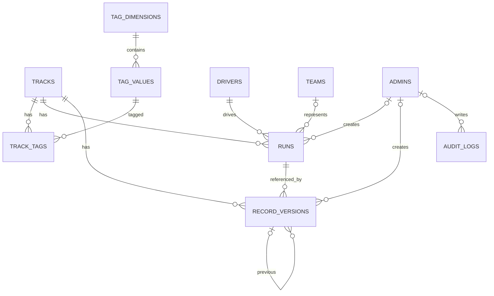

# QQ 飞车手游国服记录榜 · 数据模型

> 文档版本：v0.1  
> 更新日期：2026-11-09  
> 关联文档：[需求文档](./需求文档.md) · [核心流程](./核心流程.md)

## 1. 设计原则

1. **成绩与榜单版本分离**：`runs` 保存“谁在什么时候跑了多少”的事实，`record_versions` 保存“哪条成绩在什么时候成为国服”的提交记录。
2. **只增不删**：成绩只做状态作废，版本只追加，日志只追加；赛道使用归档，被引用的车手、车队、标签不删除。
3. **当前记录是派生结果**：不额外维护“当前成绩”字段，始终由版本表查询得出，避免两份数据不一致。
4. **双时间轴**：`achieved_at` 是成绩达成时间，`created_at` 是版本生效时间，两者不混用。
5. **标签多对多**：赛道与标签取值通过 `track_tags` 关联，支持多维度、多选。
6. **事务保证一致性**：录入、作废、回退都在单个事务内完成；SQLite 使用 `BEGIN IMMEDIATE` 串行化写操作。

## 2. ER 图



关系说明：

- 一条赛道有多条成绩、多个版本；一条成绩只属于一条赛道。
- 一条成绩可以被多个版本引用（首次上榜一次，之后可能被恢复多次）。
- 一个版本指向一条成绩，并记录它替换的上一个版本。
- 车手、车队与成绩是一对多；车队可为空。

## 3. 建表 SQL

```sql
PRAGMA foreign_keys = ON;
PRAGMA journal_mode = WAL;

CREATE TABLE schema_migrations (
  version    INTEGER PRIMARY KEY,
  applied_at TEXT NOT NULL
);

CREATE TABLE admins (
  id            INTEGER PRIMARY KEY AUTOINCREMENT,
  username      TEXT NOT NULL UNIQUE,
  password_hash TEXT NOT NULL,
  display_name  TEXT NOT NULL,
  is_active     INTEGER NOT NULL DEFAULT 1 CHECK (is_active IN (0, 1)),
  created_at    TEXT NOT NULL,
  last_login_at TEXT
);

CREATE TABLE tracks (
  id          INTEGER PRIMARY KEY AUTOINCREMENT,
  name        TEXT NOT NULL UNIQUE,
  cover_url   TEXT,
  description TEXT,
  status      TEXT NOT NULL DEFAULT 'active' CHECK (status IN ('active', 'archived')),
  sort_order  INTEGER NOT NULL DEFAULT 0,
  created_at  TEXT NOT NULL,
  updated_at  TEXT NOT NULL
);

CREATE TABLE tag_dimensions (
  id         INTEGER PRIMARY KEY AUTOINCREMENT,
  key        TEXT NOT NULL UNIQUE,
  name       TEXT NOT NULL,
  multiple   INTEGER NOT NULL DEFAULT 1 CHECK (multiple IN (0, 1)),
  is_active  INTEGER NOT NULL DEFAULT 1 CHECK (is_active IN (0, 1)),
  sort_order INTEGER NOT NULL DEFAULT 0,
  created_at TEXT NOT NULL
);

CREATE TABLE tag_values (
  id           INTEGER PRIMARY KEY AUTOINCREMENT,
  dimension_id INTEGER NOT NULL REFERENCES tag_dimensions(id) ON DELETE RESTRICT,
  name         TEXT NOT NULL,
  is_active    INTEGER NOT NULL DEFAULT 1 CHECK (is_active IN (0, 1)),
  sort_order   INTEGER NOT NULL DEFAULT 0,
  created_at   TEXT NOT NULL,
  UNIQUE (dimension_id, name)
);

CREATE TABLE track_tags (
  track_id     INTEGER NOT NULL REFERENCES tracks(id) ON DELETE CASCADE,
  tag_value_id INTEGER NOT NULL REFERENCES tag_values(id) ON DELETE RESTRICT,
  PRIMARY KEY (track_id, tag_value_id)
);

CREATE TABLE drivers (
  id         INTEGER PRIMARY KEY AUTOINCREMENT,
  name       TEXT NOT NULL UNIQUE,
  note       TEXT,
  created_at TEXT NOT NULL,
  updated_at TEXT NOT NULL
);

CREATE TABLE teams (
  id         INTEGER PRIMARY KEY AUTOINCREMENT,
  name       TEXT NOT NULL UNIQUE,
  note       TEXT,
  created_at TEXT NOT NULL,
  updated_at TEXT NOT NULL
);

CREATE TABLE runs (
  id             INTEGER PRIMARY KEY AUTOINCREMENT,
  track_id       INTEGER NOT NULL REFERENCES tracks(id) ON DELETE RESTRICT,
  driver_id      INTEGER NOT NULL REFERENCES drivers(id) ON DELETE RESTRICT,
  team_id        INTEGER REFERENCES teams(id) ON DELETE RESTRICT,
  time_ms        INTEGER NOT NULL CHECK (time_ms > 0 AND time_ms < 6000000),
  achieved_at    TEXT NOT NULL,
  screenshot_url TEXT,
  video_url      TEXT,
  note           TEXT,
  status         TEXT NOT NULL DEFAULT 'valid' CHECK (status IN ('valid', 'voided')),
  void_reason    TEXT CHECK (void_reason IN ('bug', 'reset', 'cheat', 'boost', 'mistake', 'other')),
  void_note      TEXT,
  voided_at      TEXT,
  voided_by      INTEGER REFERENCES admins(id) ON DELETE SET NULL,
  created_at     TEXT NOT NULL,
  created_by     INTEGER REFERENCES admins(id) ON DELETE SET NULL,
  CHECK (status = 'valid' OR (void_reason IS NOT NULL AND voided_at IS NOT NULL))
);

CREATE TABLE record_versions (
  id                  INTEGER PRIMARY KEY AUTOINCREMENT,
  track_id            INTEGER NOT NULL REFERENCES tracks(id) ON DELETE RESTRICT,
  run_id              INTEGER NOT NULL REFERENCES runs(id) ON DELETE RESTRICT,
  kind                TEXT NOT NULL CHECK (kind IN ('set', 'restore')),
  previous_version_id INTEGER REFERENCES record_versions(id) ON DELETE SET NULL,
  trigger_run_id      INTEGER REFERENCES runs(id) ON DELETE RESTRICT,
  note                TEXT,
  created_at          TEXT NOT NULL,
  created_by          INTEGER REFERENCES admins(id) ON DELETE SET NULL,
  CHECK (kind <> 'restore' OR trigger_run_id IS NOT NULL)
);

CREATE TABLE audit_logs (
  id          INTEGER PRIMARY KEY AUTOINCREMENT,
  admin_id    INTEGER REFERENCES admins(id) ON DELETE SET NULL,
  action      TEXT NOT NULL,
  entity_type TEXT NOT NULL,
  entity_id   INTEGER,
  detail      TEXT,
  ip          TEXT,
  created_at  TEXT NOT NULL
);

CREATE INDEX idx_tracks_status_sort ON tracks (status, sort_order, id);
CREATE INDEX idx_tag_values_dimension ON tag_values (dimension_id, sort_order, id);
CREATE INDEX idx_track_tags_value ON track_tags (tag_value_id);
CREATE INDEX idx_runs_track_status ON runs (track_id, status, id DESC);
CREATE INDEX idx_runs_driver ON runs (driver_id);
CREATE INDEX idx_runs_team ON runs (team_id);
CREATE INDEX idx_versions_track ON record_versions (track_id, id DESC);
CREATE INDEX idx_versions_run ON record_versions (run_id);
CREATE INDEX idx_audit_created ON audit_logs (created_at DESC);
CREATE INDEX idx_audit_admin ON audit_logs (admin_id, created_at DESC);
```

约定：

- 所有时间字段存 ISO 8601 UTC 字符串，例如 `2026-11-09T08:23:04.000Z`；展示时转 `Asia/Shanghai`。
- 布尔值用 `INTEGER 0/1`。
- 成绩 `time_ms` 存毫秒整数，`1:23.456` 存 `83456`。
- JSON 字段（如 `audit_logs.detail`）以 TEXT 存序列化结果。

## 4. 表说明

### 4.1 tracks（赛道）

| 字段 | 类型 | 说明 |
| --- | --- | --- |
| `id` | INTEGER | 主键 |
| `name` | TEXT | 赛道名，全局唯一 |
| `cover_url` | TEXT | 封面图地址，可空 |
| `description` | TEXT | 备注，可空 |
| `status` | TEXT | `active` 展示；`archived` 归档，不在公开榜单展示 |
| `sort_order` | INTEGER | 手动排序，越小越靠前 |
| `created_at` / `updated_at` | TEXT | 创建、更新时间 |

归档不删除数据，详情页仍可访问，历史保留。

### 4.2 tag_dimensions（分类维度）

| 字段 | 类型 | 说明 |
| --- | --- | --- |
| `id` | INTEGER | 主键 |
| `key` | TEXT | 稳定标识，如 `difficulty`、`scene`，全局唯一 |
| `name` | TEXT | 展示名，如“难度” |
| `multiple` | INTEGER | 1 表示该维度可多选，0 表示单选 |
| `is_active` | INTEGER | 停用后不在筛选面板展示 |
| `sort_order` | INTEGER | 展示顺序 |

### 4.3 tag_values（维度取值）

| 字段 | 类型 | 说明 |
| --- | --- | --- |
| `id` | INTEGER | 主键 |
| `dimension_id` | INTEGER | 所属维度，外键 |
| `name` | TEXT | 取值名，如“5 星”“巅峰”“长图” |
| `is_active` | INTEGER | 停用后不可再选，历史关联保留 |
| `sort_order` | INTEGER | 展示顺序 |

同一维度内取值名唯一。

### 4.4 track_tags（赛道标签）

| 字段 | 类型 | 说明 |
| --- | --- | --- |
| `track_id` | INTEGER | 赛道，外键 |
| `tag_value_id` | INTEGER | 取值，外键 |

联合主键。一个赛道在同一维度可挂多个取值（多选维度），单选维度由应用层校验。

### 4.5 drivers / teams（车手 / 车队）

| 字段 | 类型 | 说明 |
| --- | --- | --- |
| `id` | INTEGER | 主键 |
| `name` | TEXT | 名称，全局唯一 |
| `note` | TEXT | 备注，可空 |
| `created_at` / `updated_at` | TEXT | 创建、更新时间 |

车手与车队不物理删除；被成绩引用时改名会同步影响所有历史展示。

### 4.6 runs（成绩）

核心事实表。一条 `run` 表示“某车手在某赛道跑出某个成绩”的一次事实。

| 字段 | 类型 | 说明 |
| --- | --- | --- |
| `id` | INTEGER | 主键 |
| `track_id` | INTEGER | 赛道，外键，必填 |
| `driver_id` | INTEGER | 车手，外键，必填 |
| `team_id` | INTEGER | 车队，外键，可空 |
| `time_ms` | INTEGER | 成绩毫秒，必须大于 0 且小于 100 分钟 |
| `achieved_at` | TEXT | 成绩达成时间，UTC |
| `screenshot_url` | TEXT | 截图地址，可空 |
| `video_url` | TEXT | 视频地址，可空 |
| `note` | TEXT | 备注，可空 |
| `status` | TEXT | `valid` 有效；`voided` 已作废 |
| `void_reason` | TEXT | 作废原因枚举，作废时必填 |
| `void_note` | TEXT | 作废补充说明 |
| `voided_at` | TEXT | 作废时间，作废时必填 |
| `voided_by` | INTEGER | 作废操作人，可空（系统修复场景） |
| `created_at` | TEXT | 录入时间 |
| `created_by` | INTEGER | 录入人 |

约束与规则：

- `status = 'voided'` 时必须有 `void_reason` 和 `voided_at`。
- 作废是软删除，不物理删除行。
- 截图保存在本地 `uploads/` 目录，数据库存相对 URL；文件随机命名，限制 5MB。
- 成绩数值与达成时间录入后不可修改；录错需作废后重新录入，保证事实可追溯。
- 元数据（车手、车队、截图、视频、备注）可改，改动写入审计日志。

### 4.7 record_versions（榜单版本）

榜单的提交记录。**当前记录永远由这张表推导，不在其他表冗余存储。**

| 字段 | 类型 | 说明 |
| --- | --- | --- |
| `id` | INTEGER | 主键，越大越新 |
| `track_id` | INTEGER | 赛道，外键 |
| `run_id` | INTEGER | 指向的成绩，外键 |
| `kind` | TEXT | `set` 新成绩上榜；`restore` 回退恢复 |
| `previous_version_id` | INTEGER | 被本次提交替换的版本，可空 |
| `trigger_run_id` | INTEGER | 触发本次恢复的已作废成绩，`restore` 必填 |
| `note` | TEXT | 备注，可空 |
| `created_at` | TEXT | 版本生效时间 |
| `created_by` | INTEGER | 操作人 |

- `set`：录入一条新成绩时创建，`run_id` 指向新成绩。
- `restore`：当前成绩被作废后创建，`run_id` 指向上一条有效成绩，`trigger_run_id` 指向被作废的成绩。
- 版本只追加，不修改、不删除。
- 一条成绩可以被多个版本引用：首次上榜一次，之后可能被恢复多次。

### 4.8 admins（管理员）

| 字段 | 类型 | 说明 |
| --- | --- | --- |
| `id` | INTEGER | 主键 |
| `username` | TEXT | 登录名，唯一 |
| `password_hash` | TEXT | scrypt 哈希，不存明文 |
| `display_name` | TEXT | 展示名 |
| `is_active` | INTEGER | 停用后不能登录 |
| `created_at` | TEXT | 创建时间 |
| `last_login_at` | TEXT | 最近登录时间 |

v1 只有单个管理员，通过初始化命令或环境变量创建。

### 4.9 audit_logs（操作日志）

| 字段 | 类型 | 说明 |
| --- | --- | --- |
| `id` | INTEGER | 主键 |
| `admin_id` | INTEGER | 操作人，可空（系统动作） |
| `action` | TEXT | 动作，如 `run.create`、`run.void`、`track.update` |
| `entity_type` | TEXT | 实体类型，如 `run`、`track`、`driver` |
| `entity_id` | INTEGER | 实体 ID |
| `detail` | TEXT | JSON，记录变更前后值、原因等 |
| `ip` | TEXT | 来源 IP |
| `created_at` | TEXT | 时间 |

日志只增不改，不提供删除入口。

## 5. 状态与枚举

### 5.1 成绩状态

```text
valid ──作废──▶ voided
```

v1 不支持从 `voided` 回到 `valid`。误作废通过重新录入正确成绩解决，历史保留。

### 5.2 版本类型

| 值 | 含义 | 何时创建 |
| --- | --- | --- |
| `set` | 新成绩上榜 | 录入一条合法新成绩时 |
| `restore` | 恢复旧成绩 | 当前版本指向的成绩被作废时 |

### 5.3 作废原因

| 值 | 展示名 |
| --- | --- |
| `bug` | 游戏漏洞 |
| `reset` | 卡复位 |
| `cheat` | 外挂 / 第三方 |
| `boost` | 代跑 / 借号 |
| `mistake` | 录入错误 |
| `other` | 其他 |

## 6. 关键查询

### 6.1 单赛道当前国服

```sql
SELECT
  v.id             AS version_id,
  v.kind,
  v.created_at     AS effective_from,
  r.id             AS run_id,
  r.time_ms,
  r.achieved_at,
  r.screenshot_url,
  r.video_url,
  d.name           AS driver_name,
  t.name           AS team_name
FROM record_versions v
JOIN runs r    ON r.id = v.run_id
JOIN drivers d ON d.id = r.driver_id
LEFT JOIN teams t ON t.id = r.team_id
WHERE v.track_id = ?
  AND r.status = 'valid'
ORDER BY v.id DESC
LIMIT 1;
```

没有结果即“暂无国服记录”。

### 6.2 榜单：每条赛道取当前版本

```sql
WITH ranked AS (
  SELECT
    v.id         AS version_id,
    v.track_id,
    v.run_id,
    v.created_at AS effective_from,
    ROW_NUMBER() OVER (
      PARTITION BY v.track_id
      ORDER BY v.id DESC
    ) AS rn
  FROM record_versions v
  JOIN runs r ON r.id = v.run_id
  WHERE r.status = 'valid'
)
SELECT
  tr.id,
  tr.name,
  tr.cover_url,
  c.version_id,
  c.effective_from,
  r.time_ms,
  r.achieved_at,
  d.name AS driver_name,
  tm.name AS team_name
FROM tracks tr
LEFT JOIN ranked c ON c.track_id = tr.id AND c.rn = 1
LEFT JOIN runs r   ON r.id = c.run_id
LEFT JOIN drivers d ON d.id = r.driver_id
LEFT JOIN teams tm  ON tm.id = r.team_id
WHERE tr.status = 'active'
ORDER BY tr.sort_order, tr.id;
```

### 6.3 赛道历史版本

```sql
SELECT
  v.id,
  v.kind,
  v.created_at,
  v.previous_version_id,
  v.trigger_run_id,
  r.id           AS run_id,
  r.time_ms,
  r.achieved_at,
  r.status       AS run_status,
  r.void_reason,
  r.voided_at,
  d.name         AS driver_name,
  t.name         AS team_name,
  a.display_name AS created_by_name
FROM record_versions v
JOIN runs r     ON r.id = v.run_id
JOIN drivers d  ON d.id = r.driver_id
LEFT JOIN teams t ON t.id = r.team_id
LEFT JOIN admins a ON a.id = v.created_by
WHERE v.track_id = ?
ORDER BY v.id DESC;
```

每条版本的“结束时间” = 下一条版本的 `created_at`；最后一条持续至今。作废版本的结束时间取 `voided_at`。

### 6.4 查找上一条有效版本

```sql
SELECT v.id, v.run_id, v.created_at
FROM record_versions v
JOIN runs r ON r.id = v.run_id
WHERE v.track_id = ?
  AND v.id < ?
  AND r.status = 'valid'
ORDER BY v.id DESC
LIMIT 1;
```

参数为赛道 ID 和当前（失效）版本 ID。

### 6.5 车手国服数量

```sql
WITH ranked AS (
  SELECT
    v.track_id,
    v.run_id,
    ROW_NUMBER() OVER (
      PARTITION BY v.track_id
      ORDER BY v.id DESC
    ) AS rn
  FROM record_versions v
  JOIN runs r ON r.id = v.run_id
  WHERE r.status = 'valid'
)
SELECT d.id, d.name, COUNT(*) AS record_count
FROM ranked c
JOIN runs r    ON r.id = c.run_id
JOIN drivers d ON d.id = r.driver_id
WHERE c.rn = 1
GROUP BY d.id, d.name
ORDER BY record_count DESC, d.name;
```

车队统计把 `drivers` 换成 `teams` 即可。

## 7. 事务与并发

### 7.1 录入成绩

```text
BEGIN IMMEDIATE;

1. 读取该赛道当前有效版本（按 §6.1）。
2. 若存在当前记录，校验新成绩严格更快；相同或更慢则回滚并报错。
3. 校验重复：同赛道 + 车手 + 成绩 + 达成时间。
4. INSERT runs，status = 'valid'。
5. INSERT record_versions：
   - kind = 'set'
   - run_id = 新成绩
   - previous_version_id = 当前版本 ID（没有则 NULL）
6. INSERT audit_logs，action = 'run.create'。
7. COMMIT。
```

### 7.2 作废并自动回退

```text
BEGIN IMMEDIATE;

1. 读取并锁定该成绩；已作废则报错。
2. UPDATE runs SET status = 'voided'、void_reason、void_note、voided_at、voided_by。
3. 读取该赛道 id 最大的版本（不限成绩状态）。
4. 如果该版本的 run 仍有效：说明作废的是历史成绩，当前记录不变，跳到第 6 步。
5. 如果该版本的 run 已失效：
   a. 查找它之前最近一条有效版本（§6.4）。
   b. 若存在，INSERT record_versions：
      - kind = 'restore'
      - run_id = 上一条有效版本的 run_id
      - previous_version_id = 当前失效版本 ID
      - trigger_run_id = 被作废成绩 ID
   c. 若不存在，不插入版本，榜单自然变为“暂无记录”。
6. INSERT audit_logs，action = 'run.void'，detail 记录作废原因、回退目标和版本 ID。
7. COMMIT。
```

关键点：**先作废成绩，再检查“最新版本是否失效”**，而不是只看被作废的是不是当前记录。这样能正确处理“作废历史成绩，但该成绩曾被恢复为当前版本”的级联情况。

### 7.3 并发

- SQLite 同一时刻只允许一个写事务；使用 `BEGIN IMMEDIATE` 让写事务排队，避免两个管理员同时录入导致“当前记录”判断失效。
- 连接设置 `busy_timeout = 5000`。
- 读多写少场景开启 WAL，读不阻塞写。
- “每条赛道最多一个当前版本”是查询层保证：按 `id DESC` 取第一条有效版本，天然唯一，不需要额外唯一索引。

### 7.4 数据修复

如果因为异常出现“最新版本指向已作废成绩、但没有恢复版本”，提供一个只读检查 + 修复命令：

```sql
-- 检查：最新版本失效的赛道
WITH latest AS (
  SELECT v.track_id, v.id AS version_id, v.run_id,
         ROW_NUMBER() OVER (PARTITION BY v.track_id ORDER BY v.id DESC) AS rn
  FROM record_versions v
)
SELECT l.track_id, l.version_id, r.status
FROM latest l
JOIN runs r ON r.id = l.run_id
WHERE l.rn = 1 AND r.status = 'voided';
```

修复时按 §7.2 第 5 步补恢复版本，并写审计日志。

## 8. 初始化与默认分类

### 8.1 管理员初始化

- 从环境变量 `ADMIN_USERNAME`、`ADMIN_PASSWORD` 读取。
- 使用 Node `crypto.scrypt` 生成哈希，格式建议 `scrypt$N$r$p$salt$hash`。
- 首次启动时若不存在管理员则创建；已存在则跳过，不覆盖密码。

### 8.2 默认分类维度

| key | 名称 | multiple | 默认取值 |
| --- | --- | --- | --- |
| `difficulty` | 难度 | 0（单选） | 1 星、2 星、3 星、4 星、5 星 |
| `scene` | 场景 | 1（多选） | 巅峰、排位、联赛 |
| `length` | 长度 | 0（单选） | 长图、中长图、短图 |
| `terrain` | 地形 | 1（多选） | 腾空、平地、加速 |

维度和取值均可在后台增删改；这些只是初始数据。

### 8.3 赛道数据

v1 不预置官方全量赛道，避免名称或分类不准。由管理员在后台新增；后续可做 CSV 导入。

## 9. 迁移与备份

- 使用 `schema_migrations` 记录版本号，每次结构变更新增一个迁移文件。
- 迁移文件按 `001_init.sql`、`002_xxx.sql` 命名，启动时按序执行未应用的版本。
- 备份内容：SQLite 数据库文件 + `uploads/` 目录。
- 建议每日定时执行 `sqlite3 qqfeiche.db ".backup 'backup/qqfeiche-YYYYMMDD.db'"`，并保留最近 30 天。
- 恢复前先停止服务，避免写入中的数据库被替换。
